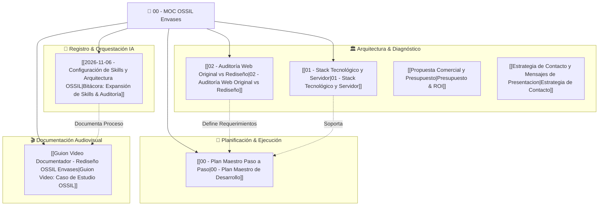

# 🏺 00 - Map of Content (MOC): E-Commerce OSSIL Envases

Bienvenido a la bóveda de ingeniería, arquitectura y dirección de arte del proyecto **OSSIL Envases** (`ossilenvases.com.ar`), distribuidora mayorista y minorista de envases para cosmética, perfumería, medicina y alimentos radicada en **Córdoba Capital, Argentina** (Oncativo 69, Local 1).

> *"En la industria cosmética y de perfumería, el envase no es un simple contenedor: es la primera promesa física de calidad de una marca. Una plataforma comercial de envases debe transmitir la misma precisión técnica, pureza material y claridad estructural que los productos que comercializa."*

> **Navegación Rápida:** [[00 - Centro de Mando|🌌 Centro de Mando]] · [[01 - MOC Ingeniería & Software|💻 MOC Ingeniería]] · [[03 - MOC Audiovisual & Media|🎬 MOC Audiovisual]]

---

## 🗺️ Mapa Arquitectónico del Proyecto

---

## 🏛️ 1. Arquitectura, Stack y Auditoría de Negocio

Documentos fundacionales que definen el salto desde una plataforma PHP legada (2015) hacia una arquitectura moderna de comercio electrónico B2B/B2C:

* **[[01 - Stack Tecnológico y Servidor|01 - Stack Tecnológico, Lenguajes y Servidor]]**
  * *Frontend & Core:* **TypeScript 5.9+** + **Next.js 16 (App Router)** + **Tailwind CSS v4** + **shadcn/ui**.
  * *Estado & Filtros:* **URL Search Params (`nuqs`)** + **Zustand** (carrito persistente con cálculo de escalas mayoristas en vivo).
  * *Visualización 3D:* **Three.js / React Three Fiber** para inspección interactiva de acabados (vidrio satinado, ámbar UV, cristal, PEAD).
  * *Base de Datos & ORM:* **PostgreSQL (Supabase)** + **Prisma ORM** + validación estricta con **Zod**.
  * *Servidor & Despliegue:* **Vercel Edge Network** (SSR/ISR de baja latencia en Argentina) + **Supabase Cloud**.
* **[[02 - Auditoría Web Original vs Rediseño|02 - Auditoría Técnica y Comercial: Web Original vs. Nueva Propuesta]]**
  * *Diagnóstico del sitio actual:* Bootstrap 3, jQuery 2.2, codificación `ISO-8859-1`, sin filtros facetados multicriterio.
  * *Lógica de negocio crítica:* Escalas de descuento por volumen ($1\text{ u.} \to 10\text{ u.} \to 25\text{ u.} \to 50\text{ u.} \to 100\text{ u.+}$ con hasta $28\%$ OFF) y compatibilidad milimétrica de roscas (`18/415`, `20/410`, `24/410`, `28/400`, `Engrimpe 15mm`).

---

## 📐 2. Plan Maestro de Desarrollo

Hoja de ruta modular por fases para llevar el proyecto desde el prototipo interactivo hasta producción:

* **[[00 - Plan Maestro Paso a Paso|00 - Plan Maestro Paso a Paso (Fases 0 a 7)]]**
  * *Ubicación del código fuente en PC:* `/home/spukerrs/Documentos/OSSIL-Envases` (y acceso directo en `/home/spukerrs/Proyectos/OSSIL-Envases`).

---

## 📓 3. Bitácoras de Ingeniería Asistida por IA

Registro cronológico y técnico de la preparación del entorno, instalación de skills especializadas y análisis automatizado:

* **[[2026-11-06 - Configuración de Skills y Arquitectura OSSIL|Bitácora: 2026-11-06 — Expansión del Ecosistema de Skills (96 Skills) y Radiografía OSSIL]]**
  * *Hito:* Identificación de 5 brechas full-stack (SEO técnico/local, Testing E2E Playwright, Estado React/URL, Core Web Vitals/WCAG 2.2 y SQL/ORM Prisma/Supabase) e instalación global en Antigravity IDE y CLI.

---

## 🎬 4. Producción Audiovisual & Caso de Estudio

Material narrativo y técnico para documentar el proceso en video (YouTube / Reels / Portfolio):

* **[[Guion Video Documentador - Rediseño OSSIL Envases|Guion Técnico y Narrativo: "Cómo rediseñé un E-Commerce Industrial con IA Agéntica"]]**
  * *Estructura:* Gancho de retención (0-15s), radiografía del sitio viejo, ingeniería de filtros y precios mayoristas, visor 3D de envases, stack moderno y cierre.

---

## 📊 Resumen de Fichas del Proyecto

| Documento | Categoría | Estado | Ruta en Bóveda |
| :--- | :--- | :--- | :--- |
| **Stack Tecnológico y Servidor** | Arquitectura & Infraestructura | `Definido` | [[01 - Stack Tecnológico y Servidor]] |
| **Auditoría Web Original vs Rediseño** | UX/UI & Negocio B2B | `Completado` | [[02 - Auditoría Web Original vs Rediseño]] |
| **Plan Maestro Paso a Paso** | Roadmap de Ingeniería | `Activo` | [[00 - Plan Maestro Paso a Paso]] |
| **Bitácora 2026-11-06** | Registro IA & Skills | `Completado` | [[2026-11-06 - Configuración de Skills y Arquitectura OSSIL]] |
| **Guion Video Documentador** | Audiovisual / YouTube | `Listo para Grabar` | [[Guion Video Documentador - Rediseño OSSIL Envases]] |
| **Presupuesto y Propuesta Comercial** | Comercial & Cotización | `Presentación` | [[Propuesta Comercial y Presupuesto]] |
| **Estrategia de Contacto y Mensajes** | Comercial & Pitch | `Listo para Enviar` | [[Estrategia de Contacto y Mensajes de Presentacion]] |
