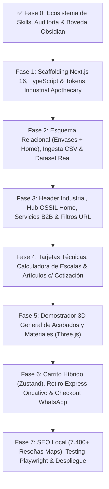

---

title: "00 - Plan Maestro Paso a Paso | Rediseño OSSIL Envases & OSSIL Home"
author: "Shair Fernando Cuello López"
alias: ["Plan Maestro OSSIL", "Roadmap OSSIL Envases"]
created: 2026-11-06
updated: 2026-11-06
status: "En Ejecución & Actualizado"
tags:

- "#plan-de-desarrollo"
- "#roadmap"
- "#ossil-envases"
- "#ossil-home"
- "#nextjs"
- "#ecommerce"

---

# 📐 00 - Plan Maestro Paso a Paso: E-Commerce OSSIL Envases & OSSIL Home

> **Volver al MOC:** [[00 - MOC OSSIL Envases]] · **Stack:** [[01 - Stack Tecnológico y Servidor]] · **Auditoría:** [[02 - Auditoría Web Original vs Rediseño]] · **Presupuesto:** [[Propuesta Comercial y Presupuesto]]

Este plan estructura la construcción integral de la nueva plataforma mayorista y minorista de **OSSIL Envases & OSSIL Home** en `/home/spukerrs/Documentos/OSSIL-Envases`, dividiendo la ingeniería en **8 fases modulares verificables** ajustadas a la realidad operativa del catálogo de **1.316 productos**.

---

## 🗺️ Diagrama de Flujo de Fases

---

## 📋 Detalle de Fases y Entregables

### ✅ Fase 0: Preparación del Entorno, Skills y Documentación (Completado)

- **Objetivo:** Equipar a Antigravity IDE/CLI con capacidades full-stack avanzadas, relevar el sitio en vivo (`ossilenvases.com.ar`) y establecer la arquitectura documental en Obsidian.
- **Acciones realizadas:**
  1. Auditoría del catálogo real: 1.316 productos clasificados en **OSSIL ENVASES (796 productos)** y **OSSIL HOME (520 productos)**.
  2. Identificación de 5 áreas de vacíos técnicos e instalación global de **48 nuevas skills** (totalizando **96 skills activas**).
  3. Detección de fallas críticas en la web actual: servidor Plesk con PHP 7.3, etiquetas de código rotas (`[SCR_P]`), Quita Esmalte a $9 en home, error `LOCATION_DATA` en modal de retiro y 7.466 reseñas de Google Maps sin aprovechar.
  4. Creación del workspace `/home/spukerrs/Documentos/OSSIL-Envases` y estructuración del módulo `13 - OSSIL Envases` en Obsidian.

---

### 🏗️ Fase 1: Scaffolding Next.js 16, TypeScript Estricto y Sistema de Diseño

- **Skills activas:** `nextjs-app-router-patterns`, `tailwind-4-docs`, `design-taste-frontend`, `ui-ux-pro-max`.
- **Tareas:**
  1. Inicializar Next.js 16 (App Router) con TypeScript 5.9+, Tailwind CSS v4, `shadcn/ui`, `lucide-react` y `motion`.
  2. Configurar tipografías: `Plus Jakarta Sans` (editorial para títulos y navegación) y `JetBrains Mono` (roscas `18/415`, `24/410`, volúmenes `50 cc` y precios tabulares).
  3. Establecer tokens semánticos **Industrial Apothecary**:
     - Fondo `#FAF8F5`, Tarjetas `#FFFFFF` con borde $1\text{px}$ `#E6E2DC`, Texto `#141413`, Bronce OSSIL `#9E734E`, Ámbar descuento `#B45309`.

---

### 🗄️ Fase 2: Modelado de Datos Relacional (Prisma/PostgreSQL) e Importación Masiva (Excel/CSV)

- **Skills activas:** `prisma-orm-setup`, `prisma-client-api`, `supabase-postgres-best-practices`, `mastering-typescript`.
- **Tareas:**
  1. Diseñar `prisma/schema.prisma` con soporte para ambas unidades de negocio:
     - `BusinessUnit`: `ENVASES` (796 productos) vs. `HOME` (520 productos).
     - `Category`: Perfumería, Cosmética, Medicinal, Alimentos, Bidones, Bazar/Cocina, Velas/Difusores, Bombas y Tapas.
     - `Product`: SKU, nombre, unidad de medida (`cc`/`ml`/`gr`/`unidades`), material, acabado, rosca `neckThread`, `requiresManualQuote: boolean`.
     - `PriceTier`: Tramos de escala ($1, 10, 25, 50, 100, 200\text{ u.}$) con sus descuentos porcentuales y precio unitario.
     - `CompatibleAccessory`: Relación por milímetro de rosca entre botellas y tapas/válvulas.
  2. **Pipeline de Ingesta Masiva (CSV / Excel):** Crear un módulo para importar y actualizar en bloque listas de precios completas desde archivos Excel exportados del sistema de gestión local de OSSIL, resolviendo la actualización ágil frente a la inflación en Argentina sin carga manual.

---

### 🧭 Fase 3: Header Industrial, Hub OSSIL Home, Servicios B2B y Filtros en URL

- **Skills activas:** `react-state-management`, `product-proof-saas`, `emil-design-eng`.
- **Tareas:**
  1. **Navegación Unificada Dual:** Selector visual superior para alternar fluidamente entre **OSSIL ENVASES** (industrial, farmacia, cosmética) y **OSSIL HOME** (bazar, termos, mates y velas/jabones).
  2. **Landing de Servicios B2B de Personalización:** Página dedicada para cotizar trabajos de **Satinado, Vitrificado, Tampografía y Serigrafía industrial** en vidrio y plástico (hoy ocultos en el footer).
  3. **Reemplazo de Linktree (`/links`):** Vista optimizada para móvil dentro del dominio de OSSIL para unificar enlaces de Instagram, WhatsApp, catálogo y ubicación con horarios correctos.
  4. **Filtros Facetados en URL (`searchParams`):**
     - Filtro por **Unidad & Rubro** (Envases vs. Home).
     - Filtro por **Material** (Vidrio, PET, PEAD, Acrílico, Hojalata/Aluminio).
     - Filtro por **Rosca / Cierre** (`18/415`, `20/410`, `24/410`, `28/400`, `B/E 15`).
     - Filtro por **Capacidad / Peso** ($3\text{ cc}$ a $5000\text{ cc}$ / gramos).

---

### 📦 Fase 4: Tarjetas Técnicas, Calculadora de Escalas y Artículos con Cotización Manual

- **Skills activas:** `page-cro`, `pricing-page`, `vercel-composition-patterns`.
- **Tareas:**
  1. **Card de Producto B2B:** Badge de material y rosca (`24/410 · PET AMBAR`), precio minorista base y mejor precio mayorista ($100\text{ u. } -28\%\text{ OFF}$).
  2. **Manejo de Artículos con Cotización Previa:** Si el producto tiene `requiresManualQuote: true`, la tarjeta y la ficha muestran el aviso oficial: _"Precio mayorista a cotizar por asesor"_.
  3. **Ficha de Producto con Match Automático de Tapas:** Cargar una botella despliega inmediatamente la lista de tapas, válvulas spray y cremeras que comparten su misma rosca, permitiendo armar el combo completo en un clic.
  4. **Prueba Social en Ficha:** Integrar el badge oficial de **4.9 estrellas en Google Maps con 7.466 reseñas** para reforzar confianza de compra inmediata.

---

### 🧊 Fase 5: Demostrador 3D General de Acabados y Materiales (Three.js / WebGL)

- **Skills activas:** `threejs-react-three-fiber`, `threejs-materials`, `threejs-lighting`.
- **Alcance Protegido para el MVP:**
  1. En lugar de modelar cientos de frascos específicos (lo que dispararía los costos y tiempos de entrega), se implementa un **visor interactivo 360° demostrador de acabados físicos PBR**.
  2. El usuario puede interactuar con una silueta de envase arquetípico y comparar en vivo cómo luce el:
     - _Vidrio Cristal Incoloro_ (transmisión óptica IOR 1.5).
     - _Vidrio Satinado / Esmerilado_ (rugosidad difusa).
     - _Vidrio Ámbar Farmacéutico_ (filtro UV cálido).
     - _Plástico PEAD Blanco / Natural_.
  3. Selector de color de válvula en tiempo real (_Spray Oro_, _Spray Plata_, _Tapa Negra_).
     _Nota:_ El modelado 3D personalizado de cada producto individual queda clasificado como un **módulo adicional para la Fase 2 (Upsell)**.

---

### 🛒 Fase 6: Carrito Híbrido, Retiro Express en Oncativo 69 y Pedido a WhatsApp

- **Skills activas:** `react-state-management`, `mastering-typescript` (Zod).
- **Tareas:**
  1. **Drawer de Carrito Inteligente con Zustand:**
     - Agrupa productos y calcula en vivo el descuento mayorista alcanzado según la cantidad de cada ítem.
     - Alerta preventiva si el cliente compra frascos pero no agregó tapas compatibles o si las cantidades no coinciden.
     - Barra de progreso motivacional: _"Agregá 4 frascos más para saltar al 17% OFF"_.
  2. **Gestión de Artículos Mixtos:** Si el carrito tiene ítems de cotización manual, genera una orden híbrida aclarando qué ítems tienen precio cerrado y cuáles quedan sujetos a cotización final de flete.
  3. **Selector de Entrega:**
     - **Retiro Express en Local (Oncativo 69, Córdoba):** Corrige el bug viejo de `LOCATION_DATA` mostrando mapa, horarios exactos y voucher de retiro rápido para evitar colas.
     - **Envío al Interior / País:** Solicitud de datos de transporte y código postal.
  4. **Checkout a WhatsApp:** Genera el mensaje formateado con SKU, descripción técnica, roscas, cantidades, subtotal y medio de pago directo al número de ventas de OSSIL.

---

### 🚀 Fase 7: SEO Local Córdoba, Testing Playwright E2E y Despliegue en Staging

- **Skills activas:** `seo-local-seo`, `seo-schema-structured-data`, `react-doctor`, `playwright-best-practices`, `deploy-to-vercel`.
- **Tareas:**
  1. Inyección de **JSON-LD Schema.org**:
     - `LocalBusiness` con coordenadas de Oncativo 69, teléfono, horarios y agregación de las 7.466 reseñas de Google Maps.
     - `Product` con `AggregateOffer` para indexar precios minoristas y mayoristas.
  2. Limpieza de redirecciones 301 para evitar errores 404 en las URLs huérfanas heredadas de Pygma/WordPress.
  3. Pruebas E2E automatizadas con **Playwright** que validen la navegación, filtros de rosca, carga de CSV de precios y armado de pedidos.
  4. Despliegue en entorno de staging privado (`ossil-preview.vercel.app`) para revisión y aprobación de los dueños de OSSIL Envases.
