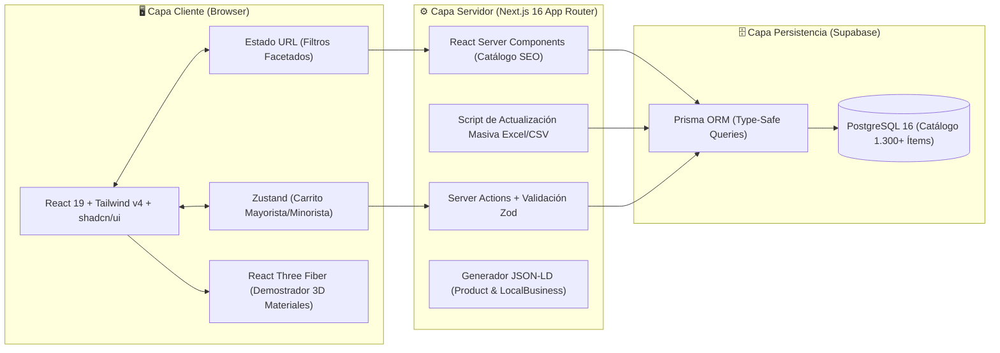

# 🛠️ 01 - Stack Tecnológico, Lenguajes y Arquitectura de Servidor

> **Volver al MOC:** [[00 - MOC OSSIL Envases]] · **Ver Plan:** [[00 - Plan Maestro Paso a Paso]] · **Presupuesto:** [[Propuesta Comercial y Presupuesto]]

Este documento define las tecnologías, lenguajes de programación, motores de base de datos e infraestructura de servidor seleccionados para la modernización integral de **OSSIL Envases & OSSIL Home**. Cada decisión técnica responde a un requerimiento comercial real de un catálogo mixto B2B/B2C de más de **1.300 productos**.

---

## 🧬 1. Lenguajes de Programación y Tipado

| Lenguaje / Estándar | Rol en el Proyecto | Justificación de Ingeniería |
| :--- | :--- | :--- |
| **TypeScript 5.9+ (Strict Mode)** | Lenguaje principal Full-Stack (Frontend, Server Actions, API Routes y Scripts) | Garantiza contratos de datos inquebrantables para entidades complejas: envases, artículos de hogar/bazar, escalas de descuentos por volumen, medidas de rosca (`18/415`, `24/410`, `28/400`) y banderas de cotización manual. |
| **SQL (PostgreSQL 16)** | Motor de base de datos relacional e índices de catálogo | A diferencia de bases NoSQL, un catálogo de envases y bazar requiere relaciones estrictas muchos-a-muchos (ej. *qué válvulas spray calzan exactamente en un frasco con boca 18/415*) y tablas de precios escalonados (`PriceTier`). |
| **CSS Moderno (Tailwind CSS v4)** | Sistema de estilos y tokens semánticos | Arquitectura CSS-first sin configuración heredada pesada, variables nativas para la paleta *Industrial Apothecary* y soporte estricto para accesibilidad WCAG 2.2 AA/AAA. |
| **GLSL / Shaders (vía Three.js)** | Materiales físicos PBR en visor 3D de demostración | Simulación física de refracción en vidrio cristal, absorción UV en vidrio ámbar, rugosidad en vidrio esmerilado (*satinado*) y acabado plástico PEAD/PET. |

---

## ⚡ 2. Frameworks, Librerías y Gestión de Estado

### A. Core & Renderizado: **Next.js 16 (App Router) + React 19**
* **Server Components por defecto:** Las páginas de categoría (`/perfumeria`, `/cosmetica`, `/medicinal`, `/ossil-home`, `/bazar`, `/velas`) y fichas de producto se renderizan en el servidor con **Partial Prefetching** y **Cache Components**, logrando carga instantánea y SEO perfecto para Google.
* **Client Components aislados (`'use client'`):** Confinados únicamente a hojas interactivas: calculadora de descuentos por escala, barra de filtros rápidos, carrito lateral (*drawer*) y demostrador 3D de acabados.

### B. Manejo de Estado y Filtros: **URL State + Zustand**
* **Sincronización en URL (`searchParams`):** Cuando un cliente filtra por `?unidad=envases&rubro=perfumeria&material=vidrio&rosca=18-415`, la URL refleja exactamente esa vista. Esto permite compartir enlaces de catálogo filtrado por WhatsApp o indexar vistas específicas.
* **Zustand (con persistencia en `localStorage`):** Administra el carrito de cotización/compra. A medida que el usuario suma unidades, Zustand recalcula automáticamente el tramo mayorista (`-11%`, `-17%`, `-22%`, `-28%`) y notifica cuánto falta para el siguiente escalón.
* **Soporte para Cotización Manual:** Si un artículo posee el atributo `requiresManualQuote: true`, Zustand no fuerza un precio mayorista automático, sino que lo rotula como *"Sujeto a cotización de asesor"* dentro del desglose de pedido.

### C. Módulo Crítico: Actualización Masiva de Precios (Excel / CSV)
Dado el contexto inflacionario de Argentina y un catálogo de más de 1.300 ítems con hasta 6 tramos de precios por producto, el sistema incluye un **pipeline de ingesta masiva**:
* La administración de OSSIL puede subir un archivo `.csv` o `.xlsx` exportado desde su sistema local de Oncativo.
* Un Server Action procesa y actualiza atómicamente los precios base y sus escalas (`PriceTier`) en PostgreSQL mediante transacciones de Prisma en segundos, invalidando la caché de Next.js (`revalidatePath`) sin intervención manual ítem por ítem.

---

## 🌐 3. Infraestructura de Servidor, Modelo de Costos y Hosting

> [!IMPORTANT]
> ### Diferenciación del Modelo de Costos: Desarrollo vs. Producción Comercial
> * **Para mi entorno de desarrollo, staging y pruebas (`$0 USD/mes`):** El entorno de construcción, pruebas de código y el enlace de demostración privada (`ossil-preview.vercel.app`) opera bajo los tiers gratuitos de **Vercel Hobby** y **Supabase Free**, lo que me permite desarrollar a **costo $0 de bolsillo**.
> * **Para OSSIL Envases en Producción Comercial (Abono Mensual):**  
>   Los términos de uso de Vercel Hobby prohíben sitios comerciales de e-commerce. Para el despliegue comercial definitivo sobre `ossilenvases.com.ar`, **se le facturará a OSSIL Envases un abono mensual recurrente de mantenimiento, hosting comercial y soporte técnico** (o bien la empresa contrata el plan comercial correspondiente de Vercel Pro + Supabase Compute).

### 1. Servidor de Aplicación y CDN: **Vercel (Edge & Serverless)**
* **Por qué Vercel:** Integración nativa con Next.js 16, distribución automática de assets e imágenes optimizadas (`.webp` / `.avif`) en nodos Edge en Sudamérica (São Paulo / Buenos Aires), certificados SSL automáticos y despliegues de vista previa en cada commit.
* **Estrategia de Caché (ISR / Cache Components):** Las fichas de producto y precios escalonados se sirven desde caché ultrarrápida y se revalidan bajo demanda (`revalidateTag`) únicamente cuando se actualiza la lista de precios por CSV o stock.

### 2. Servidor de Base de Datos y Storage: **Supabase (PostgreSQL + Storage)**
* **Base de Datos Relacional (PostgreSQL):** Aloja las tablas normalizadas:
  * `BusinessUnit` (OSSIL ENVASES vs. OSSIL HOME).
  * `Category` (Perfumería, Cosmética, Medicinal, Alimenticio, Bazar/Cocina, Velas/Insumos, Accesorios).
  * `Product` (SKU, nombre, capacidad, unidad, material, acabado, rosca `neckThread`, `requiresManualQuote`).
  * `PriceTier` (Escalas por producto: $1\text{ u.}$, $10\text{ u.}$, $25\text{ u.}$, $50\text{ u.}$, $100\text{ u.+}$).
  * `ProductCompatibility` (Tabla pivote que vincula frascos con tapas y válvulas según milimetraje).
* **Row Level Security (RLS):** Lectura pública de catálogo a máxima velocidad; escritura y mutaciones protegidas para el panel de administración.

### 3. Calidad, Testing y SEO
* **Diagnóstico React:** `react-doctor` para garantizar 0 re-renders innecesarios en grillas densas.
* **Testing E2E con Playwright:** Pruebas automatizadas de flujo completo (búsqueda de frasco $\to$ match de tapa compatible $\to$ cálculo de escala mayorista $\to$ checkout WhatsApp).
* **SEO Técnico y Local:** Schema.org (`LocalBusiness` geolocalizado en Córdoba Capital + `Product` con `AggregateOffer`).
