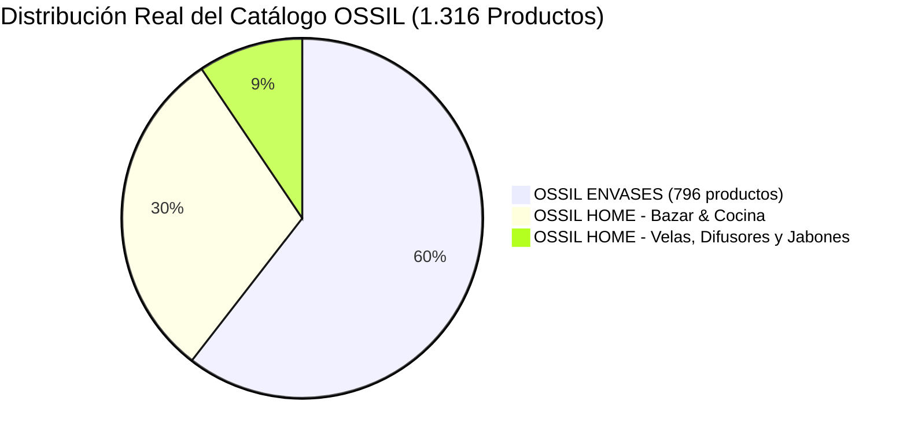

---

title: "02 - Auditoría Web Original vs Rediseño | OSSIL Envases & OSSIL Home"
author: "Shair Fernando Cuello López"
alias: ["Auditoria OSSIL", "Analisis OSSIL Envases", "Sistema de Diseño OSSIL", "Auditoria Comercial OSSIL"]
created: 2026-11-06
updated: 2026-11-06
status: "Completado & Expandido"
tags:

- "#auditoria"
- "#ux-ui"
- "#seo"
- "#sistema-de-diseno"
- "#ossil-envases"
- "#ossil-home"

---

# 🔍 02 - Auditoría Técnica, Comercial y Operativa: `ossilenvases.com.ar` vs. Nueva Arquitectura

> **Volver al MOC:** [[00 - MOC OSSIL Envases]] · **Stack Técnico:** [[01 - Stack Tecnológico y Servidor]] · **Presupuesto:** [[Propuesta Comercial y Presupuesto]]

Este documento registra la radiografía integral obtenida tras analizar el código fuente, la infraestructura de servidor, la taxonomía completa de **1.316 productos**, los canales sociales y el modelo operativo en vivo de **https://www.ossilenvases.com.ar/** el **6 de noviembre de 2026**.

---

## 🏢 1. Perfil del Negocio Real y Canales Actuales

- **Razón / Marca:** OSSIL Envases & OSSIL Home
- **Sede Física:** Oncativo 69, Local 1 — Córdoba Capital, Argentina (CP 5000).
- **Canales de Atención Directa:** WhatsApp (`+54 9 351 244-0156` / `+54 9 351 319-6225`), mostrador físico y despachos a todo el país.
- **Horarios Oficiales:** Lunes de 08:15 a 17:15 hs | Martes a Viernes de 08:00 a 17:15 hs | Sábados de 09:00 a 13:30 hs.
- **Reglas Comerciales de Pago:**
  - Efectivo, tarjeta de débito y transferencia bancaria: **0% recargo**.
  - Tarjetas de crédito bancarias y billeteras virtuales: recargo informado al momento de la compra.

---

## 🗂️ 2. Taxonomía Real del Catálogo: Dos Unidades de Negocio (1.316 Productos)

El catálogo real no está compuesto únicamente por envases industriales. De los **1.316 productos publicados**, existe una partición comercial del **60% / 40%**:

### Unidad 1: OSSIL ENVASES (796 Productos)

1. **Perfumería Fina:** Frascos de vidrio (`Equatone 30 cc`, `Tubo Liso 50 cc`, `Vip 30/60 cc`, `Xuxa 30/50 ml`, `Cuadrado 100 cc`). Sistemas de cierre: **Boca Rosca** (`B/R 15`, `B/R 18`, `18/415`) y **Boca Engrimpe** (`B/E 15`, `B/E 20`).
2. **Cosmética & Cuidado Personal:**
   - **Botellas:** Líneas `Leve`, `Venecia`, `Milano`, `Heaven`, `Sevilla`, `Lyon`, `Times`, `Esfera` en **PET** (Cristal, Ámbar) y **PEAD/PP** (Blanco, Natural).
   - **Potes:** Líneas `Rolling`, `Low`, `Tina`, `Firenze`, `Simple`, `Doble Fondo` (Acrílico, Poliestireno, PP Nacarado, PVC y Latas de Aluminio/Hojalata).
3. **Medicinal y Farmacéutico:** Goteros de vidrio (ámbar, cristal y azul), colirios, frascos jarabe (`200 cc B/R 28`) y tubos viales para laboratorios.
4. **Alimenticio & Químico:** Frascos conserveros, botellas alimenticias, bidones y baldes de alta capacidad (`1000 cc` a `5000 cc`).
5. **Bombas y Tapas (Accesorios):** Tapas `Kala`, flip-top, disc-top, bombas cremeras, válvulas atomizadoras spray (oro, plata, negro) y gatillos _trigger_.

### Unidad 2: OSSIL HOME (520 Productos — ~40% del Catálogo)

1. **Bazar, Hogar y Cocina:** Termos de acero, vasos térmicos, mates imperiales con virola, dispensers de vidrio para jabón/detergente con bomba, morteros y frascos especieros.
2. **Insumos para Velas, Difusores y Jabones (124 Productos):** Esencias puras concentradas, cera de soja para velas de molde y vaso, endurecedores, pabilos encerados, ojalillos y moldes de silicona.

### 🏭 Servicios B2B Ocultos (Oportunidad Comercial Desaprovechada)

En el pie de página de la web actual mencionan que brindan asesoramiento técnico y servicios de personalización industrial:

- **Satinado / Esmerilado** sobre frascos de vidrio.
- **Vitrificado y horneado** cerámico.
- **Tampografía y Serigrafía industrial** en envases de vidrio y plástico.  
  _Diagnóstico:_ Hoy estos servicios **no tienen una página propia, ni formulario de cotización B2B, ni galería de trabajos realizados**, perdiendo clientes corporativos que buscan packaging terminado con marca propia.

---

## ⚖️ 3. Reglas Comerciales de Precios: Escalas vs. Cotización Manual

En el relevamiento descubrimos que en la tienda conviven **dos modalidades comerciales obligatorias**:

1. **Productos con Escala Mayorista Automática:**
   La mayoría de las botellas y potes calculan su precio unitario según tramos de cantidad:
   $$\text{Minorista (1 a 9 u.)} \to \text{10 u. } (-11\%) \to \text{25 u. } (-17\%) \to \text{50 u. } (-22\%) \to \text{100 u.+ } (-28\%)$$
2. **Productos con Cotización Manual Previa (Aviso Oficial):**
   Tanto en OSSIL ENVASES como en OSSIL HOME aparece el aviso:
   > _"IMPORTANTE: Algunos productos no cuentan con precio mayorista. Al realizar tu pedido, te enviaremos la cotización de estos productos antes de realizar el pago."_  
_Solución de arquitectura:_ El sistema debe soportar el flag `requiresManualQuote: boolean`. Cuando un pedido contiene artículos de este tipo, el checkout lo categoriza como **"Solicitud de Cotización Mayorista"** y despacha el pedido directamente al WhatsApp del asesor técnico con las cantidades listas para cotizar flete y precio especial.

---

## ⚠️ 4. Hallazgos Críticos y Fallas Visibles en el Sitio Actual (Argumentario de Venta)

Estos puntos son evidencias concretas que podemos proyectar y mostrar en la reunión con los dueños para demostrar la necesidad imperiosa de renovación:

| Problema Detectado                        | Evidencia en Vivo en `ossilenvases.com.ar`                                                                                                           | Impacto en el Cliente                                                                                                          |
| :---------------------------------------- | :--------------------------------------------------------------------------------------------------------------------------------------------------- | :----------------------------------------------------------------------------------------------------------------------------- |
| **Prueba Social Desaprovechada**          | Tienen **4.9 estrellas con 7.466 reseñas reales en Google Maps**, pero en su web **no muestran ni una sola** y el botón de Maps manda a un Linktree. | Pierden la credibilidad brutal que tienen en Córdoba frente a nuevos compradores web.                                          |
| **Inconsistencias en Linktree**           | Su [Linktree](https://linktr.ee/ossil.envases.cba) dice que abren los sábados de 9 a 13:15 hs; su web y Maps dicen 9 a 13:30 hs.                     | Confusión operativa en clientes presenciales. Proponemos reemplazar Linktree por una vista propia `ossilenvases.com.ar/links`. |
| **Etiquetas de Código Rotas en Pantalla** | En la portada y categorías se leen textos crudos del sistema: `[SCR_P]W10=[/SCR_P]` y `[SCR_P]+=[/SCR_P]`.                                           | Imagen de sitio descuidado o roto.                                                                                             |
| **Precios de Prueba en Vidriera**         | En la home aparece _"Quita Esmalte x 120 cc (Cód: 693)"_ a **$ 9**.                                                                                  | Transmite desactualización de precios y genera reclamos de clientes.                                                           |
| **Pop-up de Retiro Roto**                 | En productos como _Cesto Inteligente 12 Lts_, al cliquear _"Retiro en local"_ muestra `LOCATION_DATA` en vez de la dirección Oncativo 69.            | Desconfianza al momento de elegir el retiro en local.                                                                          |
| **WhatsApp Duplicado en Footer**          | En el pie de página se repite dos veces seguidas el mismo teléfono `+5493512440156`.                                                                 | Desprolijidad de maquetación en el tema viejo.                                                                                 |
| **URLs Huérfanas de Pygma (WordPress)**   | Siguen indexadas páginas viejas de una agencia anterior (Pygma): `/quienes-somos/`, `/categoria-producto/envases/tubos/vidrio-tubos/`.               | Canibalización SEO y errores 404 que penalizan a la marca en Google.                                                           |

---

## 🎨 5. Sistema de Diseño Propuesto: _Industrial Apothecary_

Siguiendo las reglas estrictas de **Anti-Slop Visual** (`design-taste-frontend` + `frontend-design` + `ui-ux-pro-max`), descartamos cualquier gradiente neón o estética genérica de IA. Tomamos el color institucional original de OSSIL (`#BF9B77`) y lo refinamos hacia una paleta **suiza/editorial de laboratorio cosmético y boticario industrial**:

### Tokens Semánticos de Color

- **`--background` (`#FAF8F5`):** Papel técnico cálido / piedra clara que destaca la transparencia de los envases de vidrio y el blanco puro de los potes PEAD.
- **`--surface` / `--card` (`#FFFFFF`):** Superficie limpia para tarjetas técnicas de catálogo con bordes de $1\text{px}$ sutiles (`#E6E2DC`).
- **`--foreground` (`#141413`):** Carbón profundo de máximo contraste (WCAG AAA $> 14:1$) para nomenclaturas técnicas (`24/410`, `PEAD`, `cc`).
- **`--primary` (`#9E734E` / Hover `#845D3B`):** Bronce Cobre Industrial — evolución directa y sobria del `#BF9B77` original de OSSIL.
- **`--accent-amber` (`#B45309`):** Ámbar Farmacéutico — reservado para etiquetas de descuento mayorista (`-28% OFF`) y avisos de stock.
- **`--muted-foreground` (`#57534E`):** Gris piedra cálido para especificaciones secundarias y dimensiones.

### Jerarquía Tipográfica

- **Display & Títulos (`Plus Jakarta Sans`):** Geométrica, limpia y moderna con `tracking-tight` para encabezados de línea (_Perfumería Fina_, _Cosmética & Dermocosmética_, _OSSIL Home_).
- **Datos Técnicos, Roscas y Precios (`JetBrains Mono`):** Monoespaciada de precisión para códigos de rosca (`18/415`, `28/400`), capacidades (`50 cc`, `250 ml`) y tablas de precios escalonados alineadas tabularmente (`tabular-nums`).
