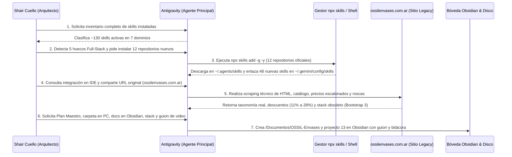

---

title: "Bitácora: Expansión del Ecosistema de Skills (96 Skills) y Radiografía de OSSIL Envases"
author: "Shair Fernando Cuello López"
alias: ["Bitacora OSSIL 2026-11-06", "Paso a Paso Skills y OSSIL"]
institution: "Instituto Privado Mixto San Agustín"
course: "6.° Año — Especialidad en Informática"
date: 2026-11-06
status: "Completado"
tags:

- "#bitacora-ia"
- "#antigravity"
- "#skills"
- "#ossil-envases"
- "#arquitectura"
- "#obsidian"

---

# 📓 Bitácora Técnica: Paso a Paso de lo Realizado (6 de noviembre de 2026)

> **Volver al MOC:** [[00 - MOC OSSIL Envases]] · **Ver Plan Maestro:** [[00 - Plan Maestro Paso a Paso]]

Este documento registra de forma cronológica, reproducible y detallada cada paso técnico ejecutado hoy en la sesión de ingeniería asistida con **Antigravity IDE**, desde la auditoría inicial de capacidades del agente hasta el diseño arquitectónico completo de **OSSIL Envases**.

---

## ⏱️ Resumen Cronológico del Flujo de Trabajo

---

## 🔢 Paso a Paso Detallado de lo que Hicimos

### Paso 1: Inventario y Auditoría Inicial de Skills del Agente

1. **Qué hicimos:** Listamos y categorizamos todas las skills preinstaladas en el entorno de Antigravity.
2. **Qué detectamos:**
   - Teníamos una base estética sobresaliente en **Frontend y Micro-interacciones** (`ui-ux-pro-max`, `frontend-design`, `emil-design-eng`, `apple-design`, `tailwind-4-docs`, `shadcn`) y bloques específicos de **Flutter/Dart**, **Firebase**, **GCP/BigQuery** y **Bioinformática**.
   - Sin embargo, para encarar un **e-commerce real de catálogo industrial grande (como OSSIL Envases)** y desarrollo Full-Stack moderno, existían **5 puntos ciegos críticos**:
     1. **SEO Técnico, Local y Schema.org (JSON-LD).**
     2. **Conversión Comercial (CRO) y Copywriting de Producto.**
     3. **Manejo de Estado Complejo y Filtros en URL (Zustand / React Query / Next.js 16 Cache).**
     4. **Visualización 3D en Navegador (Three.js / WebGL) y TypeScript Empresarial con Zod.**
     5. **Bases de Datos Relacionales SQL (PostgreSQL, Prisma ORM, Supabase) y Testing Web E2E (Playwright / React Doctor).**

---

### Paso 2: Instalación Masiva y Vinculación en el IDE de las Nuevas Skills

1. **Qué hicimos:** Ejecutamos a través del gestor oficial `npx skills add <repositorio> -g -y` la descarga de los 12 repositorios líderes del ecosistema:
   - `Autom8Minds/seo-skills` (7 skills de SEO técnico, local y JSON-LD).
   - `boraoztunc/skills` (CRO, `ogilvy-copywriting`, `pricing-page`, `product-proof-saas`, `programmatic-seo`).
   - `addyosmani/web-quality-skills` (`web-quality-audit`, `core-web-vitals`, `accessibility`, `best-practices`).
   - `Leonxlnx/taste-skill` y `pbakaus/impeccable` (`design-taste-frontend` anti-cliché).
   - `cloudai-x/threejs-skills` (13 skills de Three.js, materiales PBR, shaders, iluminación y React Three Fiber).
   - `wshobson/agents` (`react-state-management`, `nextjs-app-router-patterns`).
   - `vercel/next.js` (`next-cache-components-adoption`, `next-dev-loop`, `next-bundle-optimizer`, `next-partial-prefetching-adoption`).
   - `SpillwaveSolutions/mastering-typescript-skill` (`mastering-typescript` 5.9+ y Zod).
   - `millionco/react-doctor` (`react-doctor`, `improve-react`).
   - `currents-dev/playwright-best-practices-skill` (`playwright-best-practices`).
   - `sanyuan0704/sanyuan-skills` y `Quality-Max/free-qa-skills` (`code-review-expert`, `security-audit`, `broken-link-scan`, `console-error-scan`, `api-security-scan`).
   - `prisma/skills` y `supabase/agent-skills` (`prisma-orm-setup`, `prisma-client-api`, `prisma-postgres`, `supabase`, `supabase-postgres-best-practices`).
2. **Integración en el IDE de Antigravity:**
   - Verificamos cómo Antigravity descubre las skills globales leyendo la guía oficial `agy-customizations`.
   - Creamos mediante un script en Python los enlaces simbólicos (_symlinks_) exactos desde `~/.agents/skills/` hacia `~/.gemini/config/skills/` para las **48 skills clave**, evitando saturar el presupuesto de ventana de contexto con cientos de skills irrelevantes.
   - Validamos que los **96 archivos `SKILL.md`** en `~/.gemini/config/skills/` estuvieran íntegros (0 enlaces rotos), dejándolas activas tanto en el **IDE de Antigravity** como en la **CLI**.

---

### Paso 3: Ingeniería Inversa y Radiografía de `ossilenvases.com.ar`

1. **Qué hicimos:** Analizamos mediante peticiones HTTP y parsing con `BeautifulSoup` en Python la portada, el catálogo general (`/productos.htm`) y fichas de producto reales (como `/equatone-30-cc-18-415-satinado.html`).
2. **Hallazgos técnicos del sitio viejo:**
   - Construido hace una década sobre PHP legado, **Bootstrap 3**, **jQuery 2.2.3**, carruseles viejos (`OwlCarousel`) y codificación antigua **`ISO-8859-1`**.
   - Metaetiquetas SEO vacías (`<meta name="description" content="OSSIL Envases">`).
3. **Hallazgos comerciales clave del negocio (Córdoba Capital):**
   - **Dirección y contacto:** Oncativo 69, Local 1 (Córdoba) — WhatsApp `+54 9 351 244-0156` y `+54 9 351 319-6225`.
   - **Taxonomía de 6 grandes familias:** Perfumería, Cosmética (Botellas PET/PEAD/Vidrio y Potes), Medicinal (Goteros, Jarabes, Viales), Alimenticio, Bidones/Baldes y Bombas/Tapas.
   - **Mecánica de Precios Escalonados:** Descubrimos que el corazón del negocio es la escala por volumen:
     - $1\text{ u.} = \$1.260$ | $10\text{ u.} = \$1.121\ (-11\%)$ | $25\text{ u.} = \$1.046\ (-17\%)$ | $50\text{ u.} = \$983\ (-22\%)$ | $100\text{ u.} = \$907\ (-28\%)$.
   - **El problema de las roscas:** Cada envase lleva en su título códigos como `18/415`, `24/410`, `28/400` o `B/E 15` (boca engrimpe), pero el sitio actual no vincula automáticamente qué tapa o bomba spray le calza a cada envase.

---

### Paso 4: Definición de Arquitectura, Creación de Carpetas y Bóveda Obsidian

1. **Creación del espacio de trabajo en la PC:**
   - Carpeta principal creada en `/home/spukerrs/Documentos/OSSIL-Envases` (siguiendo el estándar de `/home/spukerrs/Documentos/Portfolio`) y enlazada en `/home/spukerrs/Proyectos/OSSIL-Envases`.
2. **Definición del Stack y Servidor:**
   - **Lenguajes:** TypeScript 5.9+, SQL (PostgreSQL), CSS (Tailwind v4), GLSL/Three.js.
   - **Framework & Estado:** Next.js 16 (App Router) + Zustand + URL Search Params.
   - **Servidor y Base de Datos:** Vercel (Edge/Serverless) + Supabase (PostgreSQL + Prisma ORM).
3. **Documentación en Obsidian (`Obsidian Sync` & `Obsidian Vault`):**
   - Creación del módulo `10 - Proyectos/13 - OSSIL Envases/` con MOC, Stack, Auditoría, Plan Maestro, esta Bitácora y el Guion para el video documentador.
   - Sincronización con el `00 - Centro de Mando.md` y los MOCs principales de la bóveda.
