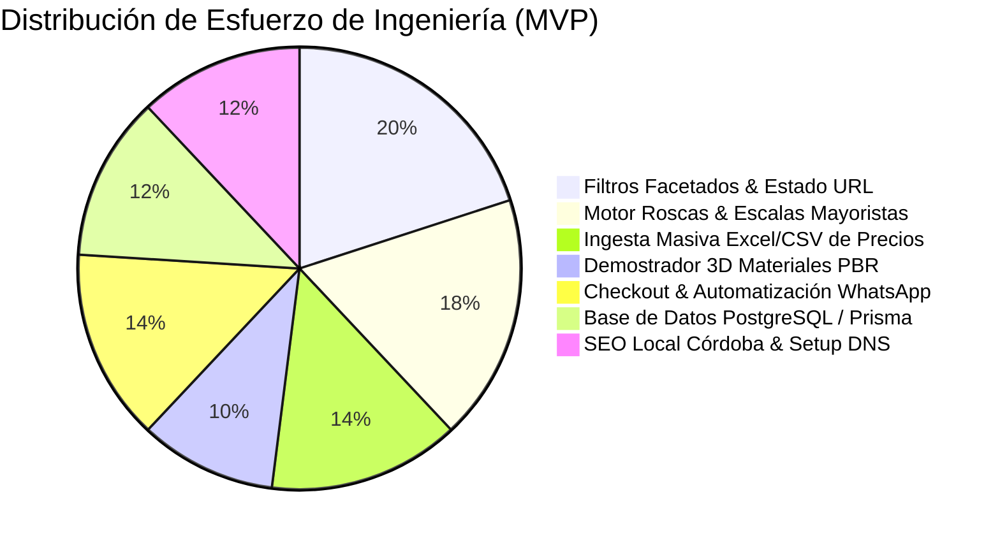

---

title: "Propuesta Comercial y Presupuesto de Desarrollo | Rediseño OSSIL Envases & OSSIL Home"
author: "Shair Fernando Cuello López"
alias: ["Presupuesto OSSIL", "Propuesta Comercial OSSIL", "Costos Mano de Obra", "Cotización OSSIL"]
role: "AI Product Builder & Software Architect"
created: 2026-11-06
updated: 2026-11-06
status: "Presentación Comercial Actualizada"
tags:

- "#presupuesto"
- "#propuesta-comercial"
- "#b2b"
- "#ecommerce"
- "#ossil-envases"
- "#ossil-home"
- "#roi"

---

# 💼 Propuesta Comercial y Presupuesto: Plataforma Digital OSSIL Envases & OSSIL Home

> **Navegación:** [[00 - MOC OSSIL Envases|MOC OSSIL]] · [[01 - Stack Tecnológico y Servidor|Stack Técnico]] · [[02 - Auditoría Web Original vs Rediseño|Auditoría Web & Argumentario]] · [[00 - Plan Maestro Paso a Paso|Plan Maestro]]

---

## 🎯 1. Diagnóstico Comercial y Argumentario de Venta para la Reunión

### El Problema Operativo Actual en Oncativo 69 (Córdoba Capital)

OSSIL cuenta con un volumen masivo de clientes presenciales y una reputación intachable en Córdoba (**4.9 estrellas sobre 5 en Google Maps con 7.466 reseñas reales**). Sin embargo, el mostrador físico y la línea de WhatsApp sufren un **cuello de botella de atención manual**:

1. **Pérdida de tiempo en consultas técnicas de roscas:** El cliente en el local pregunta: _"¿Qué rosca tiene este frasco?", "¿Qué tapa le calza?", "¿Tenés la válvula spray dorada para esta botella?"_. El vendedor debe buscar físicamente o en planillas qué accesorio coincide.
2. **Cálculo manual de precios mayoristas:** En compras por volumen ($10, 25, 50, 100\text{ u.}$), el personal calcula a mano con calculadora los porcentajes de descuento ($11\%, 17\%, 22\%, 28\%$).
3. **Catálogo mixto desaprovechado:** De los **1.316 productos publicados**, casi el 40% (**520 productos**) corresponden a **OSSIL HOME** (bazar, termos, mates, y 124 insumos para velas/jabones). Hoy ambos mundos están mezclados en un sitio de 2015 con fallas visibles.

### Evidencias Visibles del Sitio Actual para Mostrar a los Dueños:

- **Fuga de credibilidad:** Las **7.466 reseñas de Google Maps** no aparecen en su web y el botón principal de Maps manda a un Linktree externo con horarios de sábado desfasados (dice 13:15 hs en vez de 13:30 hs).
- **Etiquetas de código rotas:** En la portada y categorías se leen códigos crudos del sistema: `[SCR_P]W10=[/SCR_P]`.
- **Productos de prueba desactualizados:** En la vidriera principal figura publicado _"Quita Esmalte x 120 cc"_ a **$ 9**.
- **Error en retiro de local:** En productos de bazar, al cliquear _"Retiro en local"_ aparece el texto roto `LOCATION_DATA`.
- **Servicios B2B invisibles:** Hacen satinado, vitrificado, tampografía y serigrafía en vidrio y plástico, pero no tienen página ni cotizador para esos servicios de alto margen.

---

## 🛠️ 2. Módulos de Ingeniería del MVP

### Módulo 1: Setup, Dominio `.com.ar` y Protección de Correos (12 hs)

- Configuración de Next.js 16 + Tailwind CSS v4 + TypeScript 5.9+ y PostgreSQL en Supabase.
- Vinculación de DNS sobre `ossilenvases.com.ar` asegurando que **las casillas corporativas de correo (`mail.ossilenvases.com.ar`) en su servidor Plesk sigan funcionando al 100% sin cortes**.

### Módulo 2: Catálogo Dual (Envases + Home) y Filtros Facetados en URL (20 hs)

- Buscador predictivo por SKU, nombre, acabado y milimetraje de rosca.
- Navegación organizada en **OSSIL ENVASES** (Perfumería, Cosmética, Medicinal, Alimentos, Accesorios) y **OSSIL HOME** (Bazar, Cocina, Velas/Difusores).
- Filtros en URL compartibles por WhatsApp (`?material=vidrio&rosca=18-415&capacidad=30-100`).

### Módulo 3: Motor de Roscas, Escalas y Pipeline Masivo de Precios (18 hs)

- **Match Automático de Tapas:** Cargar un frasco muestra automáticamente las tapas, válvulas spray o goteros compatibles con su diámetro exacto.
- **Calculadora Mayorista en Vivo:** Muestra el precio unitario según tramos ($10, 25, 50, 100\text{ u.}$) y el ahorro en pesos.
- **Soporte para Artículos de Cotización Previa:** Identificación de artículos sin escala fija con el aviso oficial de cotización por asesor.
- **Actualización Masiva por Excel/CSV:** Módulo administrativo para actualizar listas de precios en segundos desde las planillas del sistema de Oncativo frente a la inflación.

### Módulo 4: Demostrador 3D de Acabados Físicos (10 hs)

- Visor interactivo 360° en Three.js / WebGL enfocado en comparar visualmente los **acabados de materiales**: Vidrio Cristal, Satinado/Esmerilado, Ámbar UV y Plástico PEAD con válvulas doradas/plateadas/negras.  
  _(El modelado 3D personalizado frasco por frasco queda como módulo opcional de Fase 2)._

### Módulo 5: Carrito Híbrido, Retiro Express y WhatsApp Directo (14 hs)

- Carrito persistente con barra de progreso de ahorro mayorista.
- **Retiro Express en Oncativo 69:** Corrige el bug de `LOCATION_DATA`, entrega voucher para evitar colas en mostrador.
- Generador de pedido ordenado que envía el detalle completo al WhatsApp de los vendedores.

### Módulo 6: Landing de Personalización B2B, SEO Local y Capacitación (12 hs)

- Sección comercial para los servicios de **Satinado, Vitrificado, Tampografía y Serigrafía**.
- Reemplazo de Linktree por landing propia `/links`.
- Integración del badge oficial con las **7.466 reseñas de Google Maps**.

---

## 💰 3. Opciones de Presupuesto

### A. Opción Recomendada: Plan MVP Inicial _(Aterrizado a primer cliente)_

Pensado para entregar una solución rápida, segura, de alto impacto comercial y sin riesgo de sobrecarga:

- **Alcance:** Catálogo completo (Envases + Home), Filtros de rosca y material, Calculadora de escalas en vivo, Soporte para artículos con cotización previa, Ingesta masiva de precios por Excel/CSV, Demostrador 3D de acabados, Retiro Express en Oncativo 69, Pedido automático a WhatsApp y Landing de Servicios B2B / Linktree propio.
- **Plazo de entrega:** 2 a 3 semanas.
- **Inversión Mano de Obra:** **$ 550.000 ARS** (Rango referencial: $450.000 a $700.000 ARS / ~**$ 450 a $ 550 USD**).
- **Forma de Pago:**
  - **40% de Anticipo Inicial ($220.000 ARS):** Firma de acuerdo, base de datos y diseño.
  - **30% con Prototipo Funcional ($165.000 ARS):** Catálogo online navegable en staging privado.
  - **30% Contra Puesta en Producción ($165.000 ARS):** Conexión al dominio oficial y capacitación al personal.

### B. Opción Referencial: Plan Integral de Agencia _(Escala Corporativa)_

- Incluye modelado 3D individual de múltiples familias de frascos, panel de administración multi-usuario con roles, pruebas E2E exhaustivas en Playwright y pasarela de cobro bancario directo: **$ 1.950 USD**.

---

## 🛡️ 4. Modelo de Costos de Servidor: Desarrollo vs. Producción

> [!IMPORTANT]
> ### Diferenciación Transparente de Costos de Infraestructura
> - **Para mi entorno de desarrollo y muestra (`$0 USD/mes`):** Durante la etapa de construcción y demostración (`ossil-preview.vercel.app`), utilizo los planes gratuitos de Vercel Hobby y Supabase, permitiéndome desarrollar con **cero costo de bolsillo**.
> - **Para OSSIL Envases en Producción Comercial (Abono Mensual):**  
>   Los términos de Vercel Hobby prohíben su uso para e-commerce comercial. Al salir a producción sobre `ossilenvases.com.ar`, la empresa abona un **fee mensual recurrente de mantenimiento, hosting comercial y soporte técnico** (o bien contrata directamente su plan comercial de Vercel Pro + Supabase).
> - **Dominio `.com.ar`:** Siguen abonando el mantenimiento anual habitual en NIC Argentina.

---

## 📈 5. Retorno de Inversión (ROI) para OSSIL Envases

- **Ahorro de más de 150 horas de trabajo al mes:** Al automatizar el asesoramiento de roscas y el cálculo de escalas, cada vendedor ahorra 10 minutos por cliente.
- **Descongestión del mostrador:** Los clientes que compran por volumen retiran su pedido armado sin esperar la fila de asesoramiento.
- **Amortización:** Con una inversión de **$ 550.000 ARS**, el costo del desarrollo se recupera en **menos de 30 a 45 días** gracias al tiempo liberado del personal y al incremento de ventas del interior provincial.
